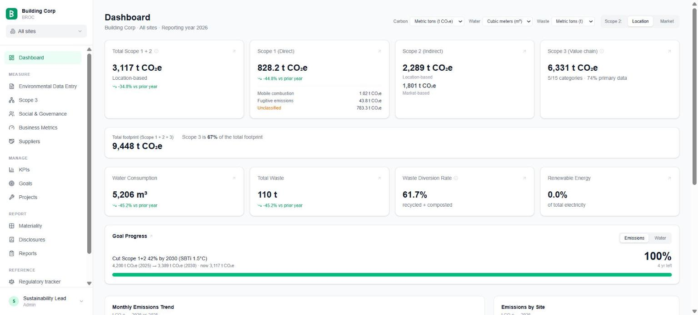
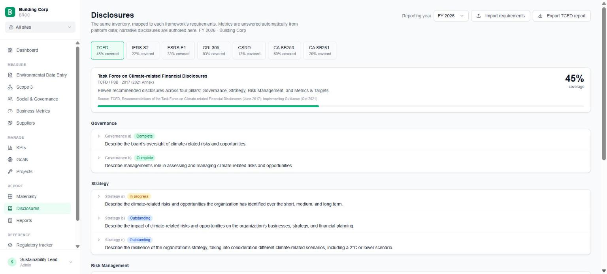
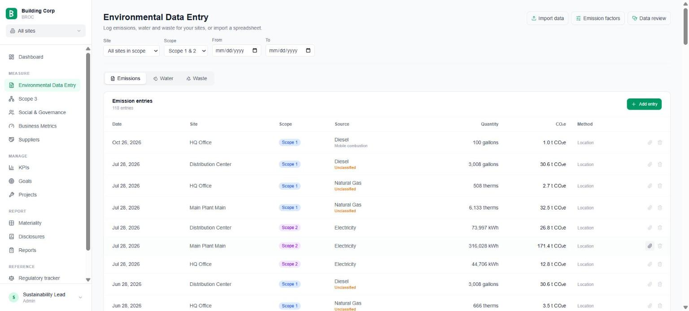
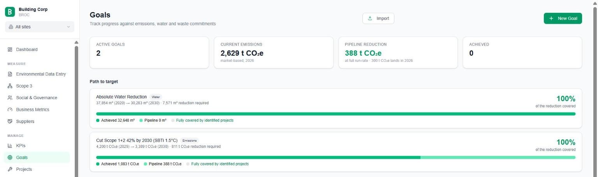
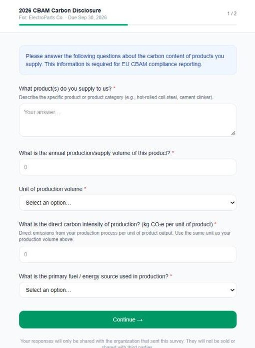

# BROC

**ESG software your team owns instead of rents.** Carbon accounting, supplier
surveys, targets and framework disclosures in one system you run yourself —
so the budget goes to reduction projects, not platform subscriptions.

Free and open source (Apache-2.0). No licence fee, no per-seat pricing, no
vendor holding your data.



## Who it's for

Sustainability teams that:

- report **Scope 1, 2 and 3** and have outgrown spreadsheets, but don't want
  an enterprise platform contract to get out of them;
- face **CSRD / ESRS, IFRS S2, TCFD, GRI, CBAM, EUDR or California SB 253/261**
  and need one set of data to answer all of them;
- need every reported number to **trace back to its source, factor and
  calculation**, because an assurance provider is going to ask;
- have someone who can run a web app — an analyst, an IT partner, or an AI
  coding assistant working from the instructions in this repository.

It is **not** a managed service. Nobody runs it for you, and there is no
vendor support line. If that is what you need, a commercial platform is the
better fit.

## What it replaces

| Today you might use | BROC gives you |
| --- | --- |
| A carbon accounting platform | Scope 1, 2 and 3 with cited emission factors and full lineage on every figure |
| A supplier survey tool | Tokenized supplier surveys — CBAM, EUDR, PFAS, carbon, or your own questions — with no supplier login |
| Target and project spreadsheets | Goals with SBTi pathways, and a reduction-project pipeline with savings estimates |
| Disclosures assembled by hand | Framework reports built from the same data, with every omission named |
| Evidence scattered across shared drives | Supporting documents attached to every reported figure, plus an append-only audit trail |

## A closer look

**One set of data, every framework.** TCFD, IFRS S2, ESRS, GRI, CSRD and the
California climate laws read from the same inventory. Metrics answer
themselves; narrative is written once.



**Every figure carries its evidence.** Activity data is entered once,
calculated with a cited factor, and can have the invoice or meter reading that
backs it attached — so an assurance provider can follow any number back to
its source.



**Targets measured against the projects that will hit them.** Set absolute,
intensity or SBTi 1.5 °C goals, then see how much of the required reduction
is already achieved and how much your project pipeline covers.



<table>
<tr>
<td width="38%" valign="top">

</td>
<td valign="top">

**Suppliers answer in a browser, with no account.** Send a link; they fill in
a CBAM, EUDR, PFAS or carbon survey and the answers land on their supplier
record, scored for data quality. CBAM declarations feed the built-in
calculator, and supplier figures feed Scope 3 Category 1.

</td>
</tr>
</table>

## What it takes to run

- **A Supabase project** (the free tier is enough to evaluate) and Node.js 20,
  or Docker. Use Supabase Cloud, or self-host Supabase — in front of your own
  PostgreSQL 15+ if you already run one ([`docs/DEPLOY.md`](docs/DEPLOY.md)).
- **An afternoon** from clone to first login, following
  [`docs/INSTALL.md`](docs/INSTALL.md). Demo data loads with one script, and
  there is a [practice workspace](docs/SANDBOX.md) for trying things safely.
- **Optional AI**, bring your own: Claude, OpenAI, or a self-hosted model. Off
  by default, and nothing depends on it.
- **Built to be changed with an AI coding assistant.**
  [`CLAUDE.md`](CLAUDE.md) and [`.claude/skills/`](.claude/skills/) teach an
  assistant the rules — never invent an emission factor, never fold Scope 3
  into the Scope 1+2 total — so your team can adapt it without breaking the
  numbers.

## How it is built to be changed

There is no admin UI for waste streams, metric vocabularies or business
metrics, and that is deliberate: **the codebase is the configuration.** Editing
a TypeScript array is how you add a waste stream, and the change is reviewable,
versioned and visible to your assurance provider. `docs/CUSTOMISING.md` maps
which changes are data and which are code. Fork it and adjust it to your needs;
see [`CONTRIBUTING.md`](CONTRIBUTING.md).

## Documentation map

| Document | What it answers |
| --- | --- |
| [`docs/INSTALL.md`](docs/INSTALL.md) | Clean install from an empty database, step by step, and what has been verified. |
| [`docs/DEPLOY.md`](docs/DEPLOY.md) | Deploying for real — managed Supabase, a single VM, or an existing Postgres. |
| [`docs/CUSTOMISING.md`](docs/CUSTOMISING.md) | Adjusting it to your organization: what is data and what is code, with a worked example. |
| [`CLAUDE.md`](CLAUDE.md) | The rulebook for an AI assistant (or a person) changing the code. |
| [`.claude/skills/`](.claude/skills/) | Step-by-step skills that teach an AI assistant how to make common changes safely. |
| [`docs/DECISIONS.md`](docs/DECISIONS.md) | The **design decisions** that must not be silently reversed, migration status, and environment notes. |
| [`docs/ARCHITECTURE.md`](docs/ARCHITECTURE.md) | How the system fits together and why. |
| [`docs/DATA_MODEL.md`](docs/DATA_MODEL.md) | Schema, tenancy, lineage, migration history. |
| [`docs/FACTORS.md`](docs/FACTORS.md) | Which public emission factor sets you can load, and how to build a factor pack. |
| [`docs/REGULATORY_CONTENT.md`](docs/REGULATORY_CONTENT.md) | Rules for adding and maintaining regulatory tracker content. |
| [`docs/SSO.md`](docs/SSO.md) · [`docs/SANDBOX.md`](docs/SANDBOX.md) | Single sign-on, and the practice workspace. |
| [`docs/TESTING.md`](docs/TESTING.md) | Manual smoke-test pass, ordered by risk. Run sections 1–3 before trusting a number. |
| [`SECURITY.md`](SECURITY.md) | Threat model, tenancy isolation, hardening, and what BROC does **not** defend against. |

## What works today

**Carbon accounting**

- **Scope 1 & 2** — activity-data entry (fuels, electricity, refrigerants), unit
  normalization, and CO₂e calculation with full lineage (raw input, factor, and
  factor source stored on every entry). Calculation happens **server-side**,
  in one write path (see SECURITY.md for its limits). Both Scope 2 figures on
  every entry per the GHG Protocol Scope 2 Guidance (contract, then residual
  mix, then a disclosed grid average), GHG Protocol Scope 1 source categories
  (stationary, mobile, process, fugitive), and biogenic CO₂ and HCFCs reported
  outside the scopes.
- **Scope 3** — all 15 categories, with an org-scoped factor library that
  **ships empty** (licensed data — you load your own via CSV) and supplier
  declarations feeding Category 1.
- **Emission factors** — cited global reference tables (EPA Hub 2024, eGRID2023,
  AIB 2023 residual mixes, IPCC AR6), checked against their publications, plus
  org-scoped, effective-dated custom overrides, entered singly or bulk-loaded
  from CSV.
- **Water & waste (EHS)** — entry, normalization, water withdrawal, discharge
  and consumption, diversion rate, recycling streams.

**Program management**

- **Dashboard & KPIs** — emissions totals, intensities, year-over-year change.
- **Goals** — absolute, intensity, net-zero, and SBTi 1.5 °C pathways (4.2 % of
  base-year emissions a year, linear; GHG only), across GHG, water and waste.
- **Projects** — reduction initiatives with per-category savings estimators,
  pro-rated by in-service date.
- **Org structure** — business-unit hierarchy, many-to-many site groups, and
  URL-driven scope filtering that applies across every module.
- **Site profile** — water source, wastewater discharge, utilities, headcount,
  operating hours, plus a per-site equipment register with refrigerant charge.

**Disclosure & assurance**

- **Frameworks** — TCFD, IFRS S2, ESRS E1, GRI 305, CSRD (full ESRS standard
  set), CA SB 253 and SB 261, with metric auto-answering and an assembled
  self-contained HTML report.
- **Double materiality** — per ESRS 1 §3, with a matrix, stakeholder divergence,
  and topic → disclosure-requirement gating, so a CSRD report demands only the
  topics assessed as material and names every omission.
- **Data review** (`/data/review`) — silent sites, reporting gaps, MoM/YoY
  variance, robust outliers, cross-site intensity, duplicates. Findings are
  review prompts carrying their numbers, never verdicts.
- **Audit trail** — trigger-based append-only log, CSV export, basis-of-preparation
  appendix on every report, and supporting-document attachments (private
  storage, signed reads) on every record that carries a reported figure.

**Supply chain**

- **Suppliers** — registry, tokenized public surveys (CBAM, EUDR, PFAS, general
  carbon, plus bespoke question sets), supplier data-quality scoring, and a
  **CBAM calculator** for embedded emissions from supplier-verified data or a
  cited EU default value (none ship: they are set per period and, for
  electricity, per country).

**Optional AI layer**

- Off by default and provider-agnostic — Claude, OpenAI, or any OpenAI-shaped
  endpoint including self-hosted. Fixed task catalogue, no free-text prompt
  endpoint, and drafts are checked for figures absent from the supplied data.
  No core feature has a code path through it.

**Outputs** — CSV exports (GHG inventory, Scope 3, EHS, supplier responses,
audit trail) and self-contained HTML framework reports.

## Stack

- **Next.js 16** (App Router) · **React 19** · **TypeScript** (strict)
- **Tailwind v4** · shadcn-style UI on Radix primitives · `recharts`
- **Supabase** (Postgres + Auth + Row Level Security + Edge Functions) —
  self-hostable
- **Resend** for transactional email

## Getting started

This section covers running BROC locally for development. **To deploy it for
real — managed, on one VM, or against a Postgres you already run — see
[`docs/DEPLOY.md`](docs/DEPLOY.md).**

### Prerequisites

- Node.js 20+
- A Supabase project (hosted or self-hosted). The Supabase CLI is used to run
  migrations and generate types.

### 1. Install

```bash
npm install
```

### 2. Configure environment

Copy the example and fill in your Supabase project values:

```bash
cp .env.example .env.local
```

| Variable | Purpose |
| --- | --- |
| `NEXT_PUBLIC_SUPABASE_URL` | Supabase project URL |
| `NEXT_PUBLIC_SUPABASE_ANON_KEY` | Public anon key (browser) |
| `SUPABASE_SERVICE_ROLE_KEY` | Service-role key — **server only**, never exposed to the client |
| `NEXT_PUBLIC_APP_URL` | Base URL used in invitation links (optional; falls back to the request's own address) |
| `ALLOW_PUBLIC_SIGNUP` | `false` by default: the first sign-up creates the organization, then `/signup` closes and colleagues join by invitation |

The `send-survey-email` Edge Function additionally needs `RESEND_API_KEY`,
`APP_URL`, and `RESEND_FROM_EMAIL` set in the Supabase function environment.

### 3. Apply the database schema

Run the numbered migrations in `supabase/migrations/` (**001–039**) in order.
Either with the Supabase CLI:

```bash
supabase db push          # applies migrations
```

…or with the bundled runner, which needs only `psql` and works against any
PostgreSQL 15+ — Supabase Cloud, a self-hosted stack, RDS, or Azure:

```bash
DATABASE_URL='postgresql://...' ./deploy/migrate.sh --dry-run   # preview
DATABASE_URL='postgresql://...' ./deploy/migrate.sh             # apply + verify
```

The runner records what it applied in a `schema_migrations` table and runs each
migration in its own transaction alongside its ledger row, so a failure leaves
the database untouched and you can simply re-run. It finishes by executing
`supabase/verify_install.sql`, which asserts the schema is actually shaped the
way the application expects.

Migrations 008 onward are written to be safely re-runnable; 001–007 are
apply-once (006 renames and drops columns). See
[`docs/DATA_MODEL.md`](docs/DATA_MODEL.md).

### Demo data (optional)

Two seeds are provided:

| File | Use |
| --- | --- |
| `supabase/seed_demo.sql` | **Recommended.** Loads demo data into the organization that already exists — the one you created by signing up. Sign up first, then run it. |
| `supabase/seed.sql` | Builds a standalone demo org with its own fixed UUIDs; requires you to create matching auth users yourself. |

`seed_demo.sql` populates 19 months of Scope 1/2 activity (so the dashboard
shows a live year-over-year comparison), water and waste, a science-based
target with a project pipeline, suppliers with CBAM declarations and survey
responses, Scope 3 entries across several categories, and a few disclosure
narratives. It is safe to re-run, and carries a commented purge block to strip
it back out.

Scope 1/2 figures use the **real** seeded reference factors (EPA 2024,
eGRID2023, IPCC AR6), so those calculations are genuine and traceable. The
Scope 3 factors are invented and labelled `DEMO DATA — not for reporting` —
load a licensed library before reporting anything real.

After any schema change, regenerate the TypeScript types so `lib/supabase/types.ts`
stays in sync:

```bash
supabase gen types typescript --linked > lib/supabase/types.ts
```

### 4. Run

```bash
npm run dev      # dev server on http://localhost:3000
```

> **Note — two bundlers.** `npm run dev` runs `next dev --webpack`, while
> `next build` uses Turbopack. This is deliberate but has caused divergence
> before (one CSS outage). If something renders in dev but not in a production
> build, check this first. See [`docs/DECISIONS.md`](docs/DECISIONS.md) §
> Environment notes.
>
> Dev chunk URLs are stable and unhashed, so a browser can serve a **stale
> bundle** after you change code — the symptom is a React hydration mismatch in
> the console. Hard-reload (`Ctrl+Shift+R`) or keep DevTools open with "Disable
> cache" checked.

## Scripts

| Command | Description |
| --- | --- |
| `npm run dev` | Start the dev server |
| `npm run build` | Production build |
| `npm run start` | Serve the production build |
| `npm run lint` | ESLint |
| `npm test` | Run the unit test suite (Vitest) |
| `npm run test:watch` | Vitest in watch mode |
| `npm run types -- --project-id <ref>` | Regenerate `lib/supabase/types.ts` safely — see below |

### Regenerating the database types

Use `npm run types`, not `supabase gen types` directly. The raw command has two
silent failure modes here: on Windows PowerShell redirection writes UTF-16, so
the file looks fine and every lookup of a new table returns nothing; and the
generator does not emit the hand-maintained convenience row types at the end of
the file, so a plain regeneration deletes about thirty-eight of them and breaks
the build in unrelated places. The wrapper normalises the encoding, restores
the aliases, and refuses to write if the output looks truncated.

## Testing

Pure business logic in `lib/` (unit conversions, the CO₂e calculation engine,
CBAM math, anomaly detection, goal progress, import validation, reporting-year
helpers) is covered by Vitest — **1,143 tests across 62 files**, including RLS tests that apply every migration to an in-process Postgres. Tests live next to
the code as `*.test.ts`. Run them with `npm test`.

The pattern to follow: logic that needs I/O gets split into a pure `*-core.ts`
holding the decisions and a thin caller that fetches. The core is what gets
tested. Keep calculation logic in `lib/`, never in components.

## Repository layout

```
app/                     Next.js App Router
  (auth)/                login, signup
  (dashboard)/           authenticated app — 12 route groups:
                         dashboard, data (+ data/factors, data/review),
                         scope3, kpis, goals, projects, suppliers,
                         materiality, disclosures, reports, settings
                         (factors/ is a permanent redirect to data/factors)
  survey/[token]/        public tokenized supplier survey
  api/                   route handlers: ai, entries, evidence, factors,
                         frameworks, invite, signup, survey
components/
  ui/                    shadcn-style primitives on Radix
  layout/                sidebar, scope picker
  forms/                 shared entry forms
  charts/                recharts wrappers
  evidence/              evidence attachment panel
.claude/skills/          skills that teach an AI assistant how to change this
                         codebase safely — ships with the repo, yours to edit
factor-packs/            tooling to build emission factor packs from a
                         publisher's own file (no factor values committed)
regulatory-packs/        tooling to turn a regulatory tracker export into a
                         loadable migration
scripts/                 maintenance scripts (safe type regeneration)
lib/                     business logic + Supabase clients (~53 modules)
  calculations.ts        CO₂e engine, project savings, SBTi pathways
  conversions.ts         unit normalization
  emission-factors.ts    factor lookups (server)
  entries.ts             the single authoritative server-side write path
  anomaly.ts             data-review analysis (pure core in anomaly-core.ts)
  report-builder.ts      self-contained HTML framework reports
  goal-metrics.ts        goal progress, shared by Goals page and dashboard
  cbam-data.ts           CBAM goods catalogue and calculator
  branding.ts            single source of truth for product naming
  regulations/           supplier survey question sets (CBAM, EUDR, PFAS)
  ai/                    optional provider-agnostic AI layer
  supabase/              client/server/service clients + generated types
  *-core.ts              pure, I/O-free logic with paired *-core.test.ts
supabase/
  migrations/            001–039, numbered SQL (source of truth for schema)
  functions/             Deno Edge Functions (send-survey-email)
  seed.sql               standalone demo org
  seed_demo.sql          demo data for your existing org (recommended)
deploy/                  Dockerfile, compose, migration runner, preflight
                         checks, Supabase self-host bootstrap
docs/                    install, deployment, customising, design decisions,
                         architecture, data model, testing
```

## Conventions

- **Server Components fetch data; interactive UI lives in sibling
  `*Client.tsx` Client Components.**
- **Every schema change is a new numbered migration** in
  `supabase/migrations/`. Never edit an applied migration.
- **RLS is mandatory** on every tenant table (`organization_id` scoping).
- **Auditability first** — every reported number traces to its source input,
  emission factor, and calculation. Never fabricate factors or regulatory
  rules; cite `factor_source` and `data_year`.

See [`CLAUDE.md`](CLAUDE.md) for the full rulebook.

## Licence

Apache License 2.0 — see [`LICENSE`](LICENSE) and [`NOTICE`](NOTICE). Use it
commercially, modify it, deploy it internally, fork it, rebrand it. The patent
grant is express, which is what most corporate legal reviews are actually
looking for.

Two things the licence does **not** cover, because they are not ours to give:

- **Emission factors.** BROC ships no proprietary factor sets. Public
  libraries (DEFRA, EPA, IEA and others) carry their own terms, and those
  travel with the data. Load what you are licensed to use.
- **Regulatory summaries.** The tracker cites primary sources for every entry
  and records how recently each was verified. It is a reference, not legal
  advice, and not a substitute for reading the instrument.
